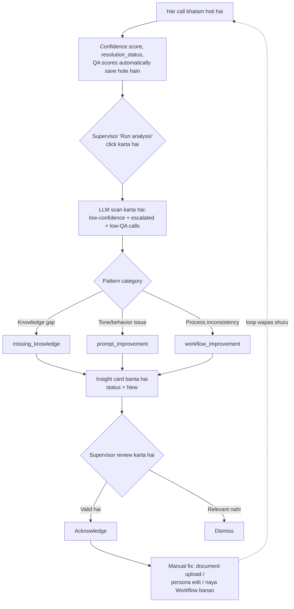
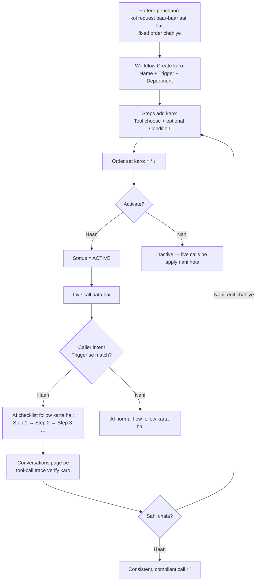
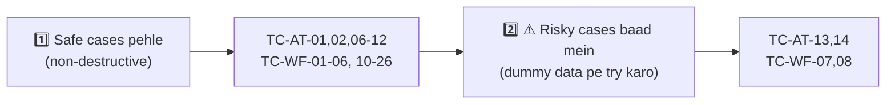

# 🧠 AI Training Center & 🔀 Workflows — Test Checklist (Hinglish)

> **Taiyaar kiya gaya:** 26 Aug 2026
> **Scope:** `/training` (AI Training Center) aur `/workflows` (Workflows) — poora process, flow diagrams, real demo examples, aur 26 manual test cases.

---

## 📋 Kaise use karein

Har test case: **ID | Element | Steps | Expected Result**.

Jo test cases **⚠️ RISKY** marked hain, wo aapke **live demo data ko permanently badal/hata dete hain** (Acknowledge, Dismiss, Delete). In cases ko ya to dummy/duplicate entry pe test karo, ya jaan-bujh kar sirf ek baar karo — **undo nahi ho sakta**.

**Priority:** Pehle non-destructive cases karo (jitni baar chaho dobara test kar sakte ho), phir ⚠️ RISKY cases sochkar karo.

---

## 🔁 Section A — AI Training Center

### Yeh kaam kaise karta hai (flow)

**Key baat:** System khud fix nahi karta — Acknowledge sirf "haan yeh valid hai" confirm karta hai. Actual fix (document upload, persona edit, workflow banana) supervisor ko khud dusre page pe jaake karna hai.

### Example (aapke demo se, real data)

> **Insight:** *"Upload detailed prior authorization and claim status information"*
> **Category:** `MISSING_KNOWLEDGE` &nbsp;·&nbsp; **Status:** `New` &nbsp;·&nbsp; **Supporting calls:** 1
>
> **Wajah:** Escalated calls mein prior-authorization aur claim-status ke sawaal the jo AI resolve nahi kar paaya, kyunki knowledge base mein relevant document nahi tha.
>
> **Fix:** Agent Studio → Knowledge base panel → PA policy PDF upload karo → agli baar AI `search_documents` se seedha jawab de payega.

> **Insight:** *"Enhance empathy and communication during identity verification"*
> **Category:** `PROMPT_IMPROVEMENT` &nbsp;·&nbsp; **Status:** `Acknowledged` &nbsp;·&nbsp; **Supporting calls:** 2
>
> **Wajah:** AI compliance sahi follow kar raha hai (identity verify kiye bina info nahi de raha), lekin tone rukha hai, jisse call unresolved reh jaati hai.
>
> **Fix:** Agent Studio → Persona textarea mein empathy/warmth ke instructions add karo.

### Test Cases

| ID | Element | Steps | Expected Result |
|---|---|---|---|
| TC-AT-01 | Page load | `/training` kholo | "AI Training Center" heading + subtitle dikhe; load hote hi insight cards ya empty-state dikhe |
| TC-AT-02 | Empty state | Us tab pe jaao jahan 0 insights hain | "No insights yet. Click 'Run analysis'…" message dikhe |
| TC-AT-03 | Error state | Backend band karke page reload karo | Laal error-banner dikhe, page crash na ho |
| TC-AT-04 | **Run analysis** button | Blue button click karo | Text "Analyzing…" ho, disable ho; khatam pe naye insights + hint message dikhe |
| TC-AT-05 | Run analysis — double-click guard | Analysis chalte waqt dobara click karo | Button already disabled, dobara trigger na ho |
| TC-AT-06 | **All** tab | Click karo | Sabhi status ke insights dikhein (default selected) |
| TC-AT-07 | **New** tab | Click karo | Sirf `status=new` insights dikhein |
| TC-AT-08 | **Acknowledged** tab | Click karo | Sirf `status=acknowledged` insights dikhein |
| TC-AT-09 | **Dismissed** tab | Click karo | Sirf `status=dismissed`, dimmed/faded card styling |
| TC-AT-10 | Category badge colors | Alag-alag category insights dekho | `missing_knowledge`=blue, `prompt_improvement`=orange, `workflow_improvement`=grey |
| TC-AT-11 | Status badge colors | New/Acknowledged/Dismissed dekho | new=orange, acknowledged=green, dismissed=grey |
| TC-AT-12 | Supporting count + date | Card footer dekho | `"N supporting example(s) · <date>"` sahi format |
| TC-AT-13 | ⚠️ **Acknowledge** button | New insight pe click karo | Status `acknowledged`, badge green, **Acknowledge button gayab** ho jaaye (permanent) |
| TC-AT-14 | ⚠️ **Dismiss** button | Kisi insight pe click karo | Status `dismissed`, card dim ho, "Dismissed" tab mein move ho |
| TC-AT-15 | Acknowledged card pe button check | Already-acknowledged card dekho | Sirf "Dismiss" dikhe, "Acknowledge" nahi (demo Card 2 jaisa) |

---

## 🔀 Section B — Workflows

### Yeh kaam kaise karta hai (flow)

**Key baat:** Workflow LLM ki flexibility ko *limit* karta hai — jo steps compliance-critical hain (jaise verify-first), unko har baar guaranteed order mein force karta hai.

### Example (aapke demo se, real data)

> **Workflow:** *Pharmacy Change Request*
> **Department:** `pharmacy` &nbsp;·&nbsp; **Status:** `ACTIVE` &nbsp;·&nbsp; **Steps:** 1
>
> **Trigger:** *"Caller wants to switch to a different pharmacy"*
>
> **Kaam kaise karta hai:** Jab bhi live call ka detected intent is trigger se match kare, AI is workflow ko checklist ki tarah follow karta hai — is demo mein abhi 1 step hai; typically aisa workflow `verify_member` → `find_pharmacy` → confirm-out-loud jaisi sequence rakhta.

### Test Cases

**List page**

| ID | Element | Steps | Expected Result |
|---|---|---|---|
| TC-WF-01 | Page load | `/workflows` kholo | Heading, existing workflow cards, "Create workflow" form dikhe |
| TC-WF-02 | Empty state | Koi workflow na ho | "No workflows yet." dikhe |
| TC-WF-03 | Card badges | "Pharmacy Change Request" jaisa card dekho | Department badge + active/inactive badge sahi dikhein |
| TC-WF-04 | Card trigger + step count | Card body dekho | `"When: <trigger>"` aur `"N step(s)"` sahi |
| TC-WF-05 | Card click → navigate | Naam/card pe click karo | Detail page `/workflows/:id` khule, fields pre-filled |
| TC-WF-06 | **Activate / Deactivate** | Button click karo | Badge turant switch ho; reversible, safe hai |
| TC-WF-07 | ⚠️ **Delete** — dialog | Red "Delete" click karo | Confirmation dialog: *"Delete workflow? …cannot be undone."* |
| TC-WF-08 | ⚠️ **Delete** — confirm | Dialog mein "Delete" confirm karo | Workflow list se **permanently** hat jaaye |
| TC-WF-09 | Delete — cancel | Dialog mein "Cancel" karo | Dialog band ho, workflow waisa hi rahe |

**Create form**

| ID | Element | Steps | Expected Result |
|---|---|---|---|
| TC-WF-10 | Name — required | Name khaali chhodo, submit karo | Required-field validation roke |
| TC-WF-11 | Trigger — required | Trigger khaali chhodo, submit karo | Required-field validation roke |
| TC-WF-12 | Department dropdown | Dropdown kholo | "All departments" + har department option dikhe |
| TC-WF-13 | **Create** — success | Valid data bharke submit karo | "Creating…" dikhe; naya card list mein aaye, form reset ho |

**Detail page**

| ID | Element | Steps | Expected Result |
|---|---|---|---|
| TC-WF-14 | Name/Trigger/Department edit | Fields edit karo | Properly update ho, koi error na aaye |
| TC-WF-15 | Active checkbox | Toggle karo | Checked/unchecked state reflect ho |
| TC-WF-16 | **+ Add step** | Click karo | Naya step row add ho, number (N+1) sahi |
| TC-WF-17 | Step tool dropdown | Kholo | Saare 12 tools dikhein (`search_documents`, `verify_member`, `search_formulary`, `find_pharmacy`, etc. — poori list neeche) |
| TC-WF-18 | Step condition input | Text likho (jaise `only if member is verified`) | Properly save ho |
| TC-WF-19 | Step **↑** move up | 2nd step pe click karo | Ek position upar move ho, numbering update ho |
| TC-WF-20 | Step **↓** move down | Kisi step pe click karo | Ek position neeche move ho |
| TC-WF-21 | ↑ disabled on first step | Pehle step ka ↑ dekho | Disabled ho |
| TC-WF-22 | ↓ disabled on last step | Aakhri step ka ↓ dekho | Disabled ho |
| TC-WF-23 | Step **Remove** | Click karo | Step list se hate, numbering update ho |
| TC-WF-24 | Zero steps hint | Saare steps remove karo | "No steps yet — add the tools…" hint dikhe |
| TC-WF-25 | **Save changes** | Edit karke Save click karo | "Saving…"; reload pe changes persist hue confirm karo |
| TC-WF-26 | Save — invalid state | Name/Trigger khaali karke Save karo | Required validation roke, save na ho |

📎 Poori 12-tool list (step dropdown mein yeh sab dikhne chahiye)

`search_documents` · `verify_member` · `check_claim_status` · `get_benefits` · `search_formulary` · `find_pharmacy` · `schedule_appointment` · `schedule_callback` · `escalate_to_human` · `create_ticket` · `send_email` · `update_customer`

---

## ✅ Suggested run order

